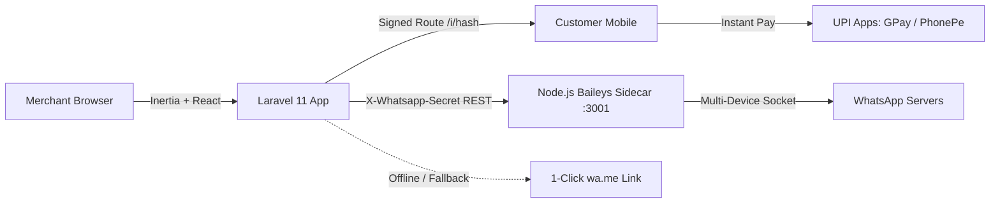

# 🚀 100% Free WhatsApp Automation & Broadcast Setup Guide
### Zero-Per-Message Cost • Self-Hosted Baileys Microservice • Multi-Device QR Auth • Anti-Ban Throttling

This billing system includes a self-hosted Node.js WhatsApp microservice powered by [`@whiskeysockets/baileys`](https://github.com/WhiskeySockets/Baileys). It allows merchants to send automated invoice PDFs, payment reminders, and customer broadcasts directly from their own WhatsApp numbers without paying Meta Cloud API fees or per-message charges.

---

## 🏗️ Architecture Overview



- **Smart Hybrid Fallback**: If the Baileys socket is connected, messages are sent automatically in the background. If disconnected or offline, the app automatically generates a 1-click `wa.me` fallback link so merchants can still notify customers instantly at ₹0 cost.
- **Anti-Ban Guard**: Broadcasts are queued with randomized **18 to 45 seconds delays** between messages, auto-randomized greetings (`Namaste`, `Hello`, `Dear`, `Pranam`), and a daily safety limit (default: 150/day).

---

## 💻 Local Development Setup

### 1. Configure Environment Variables
Ensure these keys are in your `.env` file:

```env
WHATSAPP_SIDECAR_URL=http://127.0.0.1:3001
WHATSAPP_SIDECAR_SECRET=vama_secret_change_me_in_prod
WHATSAPP_DAILY_BROADCAST_LIMIT=150
QUEUE_CONNECTION=database
```

### 2. Run Database Migrations & Seeders
```bash
php artisan migrate
php artisan db:seed --class=WhatsappTemplateSeeder
```

### 3. Start the Baileys Sidecar
Open a new terminal window:
```bash
cd whatsapp-service
npm install
npm run dev
# Running at http://127.0.0.1:3001
```

### 4. Start Laravel Queue Worker
In another terminal:
```bash
php artisan queue:work --tries=3
```

### 5. Pair WhatsApp in Merchant Dashboard
1. Log in to your application and navigate to **WhatsApp Hub** in the left sidebar menu (`/whatsapp`).
2. On the **Connect WhatsApp** tab, click **Generate QR**.
3. On your phone: Open **WhatsApp** > **Settings** (or 3 dots) > **Linked Devices** > **Link a Device**.
4. Scan the QR code displayed on your screen. The badge will instantly change to **CONNECTED (+91...)**.

---

## 🌐 Production Linux VPS Deployment (Ubuntu / Debian)

### 1. Deploy the Baileys Sidecar via PM2
Install PM2 globally if not already installed:
```bash
npm install -g pm2
```

Navigate to `whatsapp-service/` and start with PM2:
```bash
cd /var/www/vama-invoice/whatsapp-service
npm install --omit=dev
pm2 start ecosystem.config.cjs
pm2 save
pm2 startup
```

Useful PM2 commands:
```bash
pm2 status                       # View sidecar status
pm2 logs vama-whatsapp-sidecar   # View live connection and QR logs
pm2 restart vama-whatsapp-sidecar
```

### 2. Configure Laravel Queue Worker via Supervisor
Install Supervisor on your Linux server:
```bash
sudo apt-get install supervisor
```

Create `/etc/supervisor/conf.d/vama-worker.conf`:
```ini
[program:vama-worker]
process_name=%(program_name)s_%(process_num)02d
command=php /var/www/vama-invoice/artisan queue:work database --sleep=3 --tries=3 --max-time=3600
autostart=true
autorestart=true
stopasgroup=true
killasgroup=true
user=www-data
numprocs=2
redirect_stderr=true
stdout_logfile=/var/www/vama-invoice/storage/logs/worker.log
stopwaitsecs=3600
```

Start and verify Supervisor:
```bash
sudo supervisorctl reread
sudo supervisorctl update
sudo supervisorctl start vama-worker:*
```

---

## 🛡️ Anti-Ban Best Practices for Merchants
1. **Never blast unknown numbers**: Broadcast only to saved customers/parties who have previously purchased from your store.
2. **Keep the 18–45s queue delay enabled**: Do not bypass the background queue to send rapid bulk messages.
3. **Respect the daily cap**: Keep the daily limit to ≤ 150 messages/day for numbers newer than 3 months.
4. **Interactive templates**: Always encourage customers to save your number and reply with their payment confirmation.
